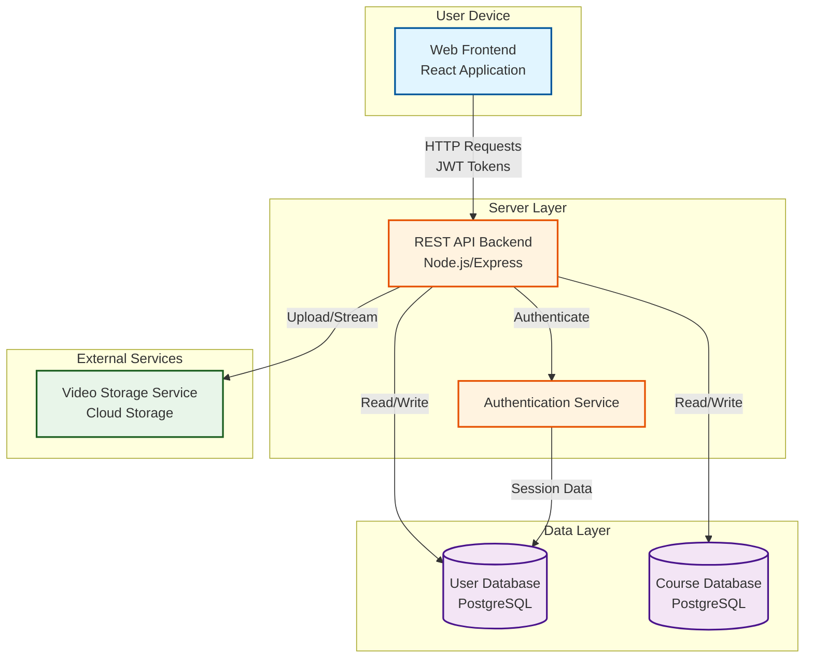
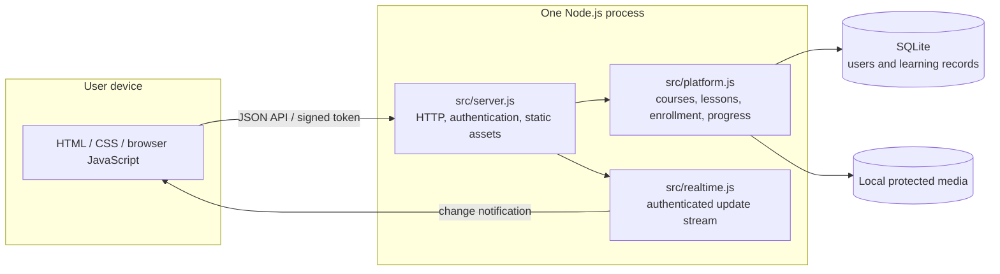

# SkillStream System Architecture — Week 3 Proposal and Current Prototype

## Original Week 3 proposal

## High-Level Architecture (Mermaid Diagram)

The diagram above is the proposed architecture, not the deployed implementation. It assumes React, Express, PostgreSQL and external video storage.

## Current local architecture

The running application keeps the same browser → server → persistent data direction, while combining those logical responsibilities in one local Node.js process. The browser uses HTML/CSS/JavaScript. `src/server.js` handles HTTP, authentication and static assets; `src/platform.js` implements course and learning operations; `src/realtime.js` delivers authenticated change notifications. SQLite stores application records, and protected video files stay in local storage.

**Figure 3.2. Current local SkillStream architecture.** The modules run in one process; the boxes show code responsibilities, not separately deployed services. The browser sends an authenticated request to the HTTP server. The server validates the session and delegates course or learning work to the platform module, which accesses SQLite or protected local files. Authenticated event notifications tell permitted browser clients when to refresh data.

## Architecture comparison

| Concern | Week 3 proposal | Current implementation | Decision and effect |
|---|---|---|---|
| Frontend | React application | Static HTML, CSS and browser JavaScript, split between `app.js`, `learning.js` and `live.js` | Kept the prototype dependency-free and runnable locally; UI and API are served by one process. |
| Application layer | Express REST API plus separate authentication service | Built-in `node:http`; authentication in `server.js`; learning rules in `platform.js`; events in `realtime.js` | Responsibilities remain modular in source but are not independent services. |
| Persistence | PostgreSQL user/course databases | One SQLite database using Node's built-in `node:sqlite` | Avoids external setup for the local demonstration; PostgreSQL migration and deployment behavior are not demonstrated. |
| Video | External/cloud video service | Protected local MP4/WebM files | Supports local upload and playback URLs; lacks CDN delivery, transcoding and multi-server storage. |
| Identity | Separate authentication service and JWT | HMAC-SHA256 signed token checked by the HTTP server | Fewer runtime components; token issuance and verification are not delegated to a separate service. |
| Enrollment workflow | REST API, database write, updated browser view | Implemented through the course API and persisted SQLite enrollment; duplicate requests return HTTP 409 | The intended end-to-end flow is present and covered by HTTP checks; full browser acceptance is still separate. |

The main design change is consolidation of proposed services into a single local server, not a change in the user-to-data flow. Course ownership, role checks and enrollment validation stay on the server. This keeps the demonstration simple to run and inspect. The trade-off is that it does not demonstrate the proposed deployment boundaries, PostgreSQL operation, cloud video, or independent scaling. No current component diagram should label React, Express, PostgreSQL, or cloud storage as implemented.

## Architecture explanation (original proposal)

Figure 3.1 presents the proposed architecture for SkillStream. The Web Frontend sends HTTP requests with JWT tokens to the REST API Backend using RESTful API endpoints. The API Backend processes requests and coordinates with the Authentication Service for user validation, the User Database for enrollment and progress data, the Course Database for course metadata, and the Video Storage Service for content delivery. This separation was selected because it provides clear separation of concerns, enables independent scaling of components, and allows for easier testing and maintenance of individual services.

## Data Flow for Student Enrollment

1. **Input**: Student clicks "Enroll" button in Web Frontend
2. **Processing**: REST API Backend receives POST request, validates JWT token via Authentication Service
3. **Storage**: API checks User Database for existing enrollment, creates new enrollment record if valid
4. **Output**: API returns success response to Web Frontend, which updates UI to show enrolled status
5. **Failure handling**: If student is already enrolled, API returns 409 Conflict error, Frontend displays appropriate message

## Component Failure Handling

- If the Web Frontend fails to connect to the API Backend, it displays a network error message and allows retry
- If the Authentication Service is unavailable, the API Backend returns 503 Service Unavailable, prompting the user to try again later
- If the Database is unreachable, the API Backend returns 503 Service Unavailable and logs the error for admin investigation
- If the Video Storage Service fails, the system displays a placeholder message and allows the student to proceed with other course content
