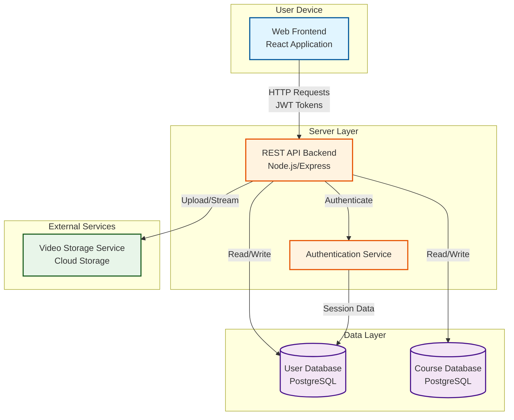

# SkillStream System Architecture Diagram

## High-Level Architecture (Mermaid Diagram)

## Architecture Explanation

Figure 3.1 presents the proposed architecture for SkillStream. The Web Frontend sends HTTP requests with JWT tokens to the REST API Backend using RESTful API endpoints. The API Backend processes requests and coordinates with the Authentication Service for user validation, the User Database for enrollment and progress data, the Course Database for course metadata, and the Video Storage Service for content delivery. This separation was selected because it provides clear separation of concerns, enables independent scaling of components, and allows for easier testing and maintenance of individual services.

## Data Flow for Student Enrollment

1. **Input**: Student clicks "Enroll" button in Web Frontend
2. **Processing**: REST API Backend receives POST request, validates JWT token via Authentication Service
3. **Storage**: API checks User Database for existing enrollment, creates new enrollment record if valid
4. **Output**: API returns success response to Web Frontend, which updates UI to show enrolled status
5. **Failure handling**: If student is already enrolled, API returns 409 Conflict error, Frontend displays appropriate message

## Component Failure Handling

- If the Web Frontend fails to connect to the API Backend, it displays a network error message and allows retry
- If the Authentication Service is unavailable, the API Backend returns 503 Service Unavailable, prompting the user to try again later
- If the Database is unreachable, the API Backend returns 503 Service Unavailable and logs the error for admin investigation
- If the Video Storage Service fails, the system displays a placeholder message and allows the student to proceed with other course content